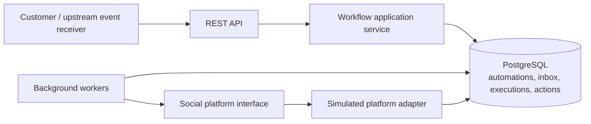

# Architecture

The service is a modular monolith: an HTTP API, a workflow application service,
and background action workers share PostgreSQL. The supported workflow is
deliberately fixed: match a comment, reply, request an email, wait, and send a
link. Automation records configure that workflow; they do not contain executable
code or a general-purpose graph.

## Components



The application layer defines the platform boundary. The simulator implements
that boundary and records accepted calls durably. A real connector can replace
it without changing workflow rules. Receiving authenticated platform webhooks,
OAuth, platform permissions, and Instagram-specific delivery policies belong to
the upstream platform integration.

`cmd/server` wires the service together. `internal/httpapi` owns REST transport;
`internal/domain` owns matching, email parsing, and valid transitions;
`internal/app` defines repository/platform ports and runs workers; and
`internal/postgres` implements atomic use cases and embedded SQL migrations.
Transactions belong to repository use cases so their state and action writes
cannot accidentally commit independently.

## Three separate lifecycles

An inbound event's identities, semantic content hash, and processing outcome are
persisted. Raw inbound text is not retained. A hash supports conflict detection;
it does not anonymize guessable input or support raw-body replay. An execution tracks
the customer's workflow. Each outbound action independently tracks delivery,
attempts, retry timing, and lease ownership. These lifecycles remain separate:
accepting an email does not mean its follow-up message has been delivered.

```mermaid
stateDiagram-v2
    [*] --> INITIAL_ACTIONS_PENDING: matching comment
    INITIAL_ACTIONS_PENDING --> WAITING_FOR_EMAIL: reply and prompt delivered
    INITIAL_ACTIONS_PENDING --> FINAL_MESSAGE_PENDING: prompt delivered; early email already captured
    WAITING_FOR_EMAIL --> WAITING_FOR_EMAIL: invalid email
    WAITING_FOR_EMAIL --> FINAL_MESSAGE_PENDING: valid email
    FINAL_MESSAGE_PENDING --> COMPLETED: final delivery acknowledged
    INITIAL_ACTIONS_PENDING --> FAILED: permanent/exhausted delivery failure
    FINAL_MESSAGE_PENDING --> FAILED: permanent/exhausted delivery failure
    WAITING_FOR_EMAIL --> EXPIRED: persistent waiting deadline elapsed
```



The waiting state consumes no worker, connection, timer, or goroutine. PostgreSQL
is the source of truth across process restarts. A valid DM arriving after
execution creation but before prompt delivery is captured immediately; the
final action becomes eligible only after the initial sequence succeeds.

## Event processing and transaction boundaries

Inbound handling is synchronous and transactional. A successful response means
that the event, its outcome, state changes, and newly scheduled logical actions
have committed. A database failure returns an error so the upstream receiver
can retry. There is no separate inbox queue to operate or reconcile.

For a comment, one transaction deduplicates the event, serializes the
conversation, finds an enabled matching automation, creates an execution with an
immutable configuration snapshot, and schedules initial work. No platform call
occurs inside this transaction.

A keyword is one Unicode letter/number token. Matching is case-insensitive and
requires a whole token: `PRICING!` matches `pricing`, while `repricing` and
`pricing2` do not. Matching is scoped to the authenticated tenant and connected
Instagram account. Eligible-post ownership is a trusted-ingress precondition,
because the assumed existing connector owns platform verification.

For a DM, one transaction deduplicates the event, serializes the conversation,
locks the active execution, validates the message, and either records an invalid
response or captures the first valid email. If the prompt has already been
delivered, the transaction also schedules the final action. Otherwise prompt
acknowledgment will schedule it later. Duplicate deliveries return the original
logical result. A reused event identifier with different content is a conflict.

For action acknowledgment, a transaction verifies current lease ownership,
records delivery, advances the execution, and schedules any next action. The
final delivery acknowledgment marks the execution completed. A permanent error
or exhausted retry budget instead records terminal failure.

## Conversation policy

Only one active execution is permitted for a tenant, connected account, platform,
and social user. A database constraint enforces this invariant, while a
conversation lock serializes competing inbound transactions. Multiple matching
automations use ascending creation time, then ID as a deterministic tie-breaker.
Further matching comments while a
conversation is active are suppressed and retain that outcome in the inbox.
They are not queued for later execution.

DMs route only to that exact active conversation. The first valid email wins;
subsequent messages cannot replace it while final delivery is pending. An
invalid email leaves the conversation waiting and sends no clarification.
An unmatched DM remains an unmatched event. A DM received before its triggering
comment is not retrospectively attached to a future execution: a plain text DM
contains no causal workflow identifier, and reusing historical email messages
would risk binding the wrong response. Receipt order, rather than a caller's
untrusted timestamp, determines this boundary.

Automation configuration is copied into the execution. Definitions are immutable
except for their enabled flag. Disabling a definition affects future matches;
active executions retain their original reply, prompt, and link. A new comment
after completion may start a new execution.
Replaying the original comment cannot.

## Workers and recovery

Workers claim eligible actions in short database transactions using row locks
and `SKIP LOCKED`. A durable lease has an expiry and a unique ownership token.
Provider calls run outside database transactions. Acknowledgment, retry, and
failure writes must match the current token, so a worker with an expired lease
cannot overwrite a newer attempt's database state.

Inbound handlers acquire the conversation lock before locking the execution.
Delivery acknowledgment, retry, and expiry follow that same order; delivery and
retry then lock the action. The claim transaction locks only its action row and
commits before a platform call. This consistent conversation → execution → action
order prevents circular state-update locking. A valid early DM and prompt
acknowledgment therefore cannot overwrite one another's changes.

Actions execute in order: comment reply, email request, then final link. A stable
action identifier is passed to the adapter on every attempt. The simulated
adapter deduplicates by that identifier. Lease recovery also handles a crash
after a successful provider call but before its acknowledgment was committed.

Real external delivery remains at least once unless the connector and provider
actually honor an idempotency key. Lease ownership cannot undo or fence an
already in-flight external call. This limitation applies to ambiguous timeouts
and lease expiry during a slow provider request.

Temporary errors use finite exponential backoff with jitter. Permanent errors
fail immediately; attempts exhausted by retries or abandoned claims fail
explicitly, including a crash that consumes the final permitted claim. The
waiting deadline starts when prompt delivery is acknowledged and applies only
to the waiting state. Expiration is checked during ingestion as well as periodic
database-backed maintenance, so a late email cannot bypass a delayed sweep.
Shutdown stops new claims, cancels work through contexts, and
leaves unfinished leases available for recovery.

## Happy path

```mermaid
sequenceDiagram
    participant U as Social user
    participant H as HTTP API
    participant D as PostgreSQL
    participant W as Worker
    participant P as Platform adapter
    U->>H: Comment: pricing
    H->>D: Commit event, execution snapshot, initial action
    H-->>U: Accepted with durable outcome
    W->>D: Claim eligible action with lease
    W->>P: Reply: Sent you a DM! (stable action ID)
    W->>D: Acknowledge reply; schedule email request
    W->>P: Request email (stable action ID)
    W->>D: Acknowledge prompt; persist waiting state
    U->>H: DM: My email is hello@example.com
    H->>D: Commit event, email, final action
    W->>D: Claim final action
    W->>P: Send configured link (stable action ID)
    W->>D: Acknowledge final delivery; complete execution
```

## Scaling and operating limits

Additional service instances share the same PostgreSQL coordination and require
no sticky routing. Distinct conversations progress independently; a single
conversation is intentionally serialized. The expected workload does not
justify Redis, Kafka, a workflow service, or independently deployed services.

At higher volume, measure claim-query latency, lock contention, database growth,
provider limits, retry rates, and oldest pending action before changing the
architecture. Likely additions are account-specific rate limits, fair scheduling,
inbox/action retention, richer provider error classification, and a verified
webhook boundary. A broker would be justified by measured database pressure or
independent consumer needs, not by the presence of asynchronous work alone.

See [decisions.md](decisions.md) for alternatives and [reliability.md](reliability.md)
for operational guarantees and failure cases.
