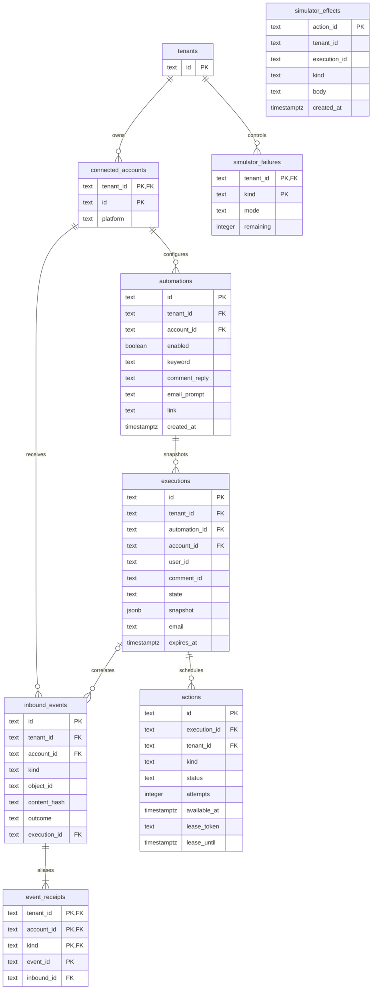

# Data model

The embedded migration is [`001_initial.up.sql`](../internal/postgres/migrations/001_initial.up.sql).
Its matching `.down.sql` reverses the schema in dependency order. Startup applies
the upward migration in one transaction under a migration advisory lock and
records schema versions 1 and 2 in `schema_migrations`. Running startup repeatedly is
safe; the down migration is intentionally a manual destructive development task.

`simulator_effects` deliberately has no foreign key to engine actions. It models
an independently committed remote side effect: accepting a message and
acknowledging its outbox action are separate transactions even though both use
the same local PostgreSQL server for the demonstration.

## Tables and invariants

| Table | Identity and relationships | Important constraints and access paths |
| --- | --- | --- |
| `tenants` | Text tenant primary key. | The demo bootstrap provisions its configured tenant; authentication assigns tenant identity before repository calls. |
| `connected_accounts` | Composite primary key `(tenant_id,id)`; foreign key to tenant. | A unique `(tenant_id,id,platform)` key backs composite account-ownership foreign keys. Only Instagram is supported. |
| `automations` | Random text ID; composite `(tenant_id,id)` unique key; tenant/account/platform foreign key. | Enabled matching index on tenant/account/platform/creation time/ID. Configuration is immutable except `enabled`; creation time and ID define winner order. |
| `executions` | Random text ID; composite tenant/ID unique key; foreign keys to tenant-owned automation and account. | Partial unique active-conversation index on tenant/account/platform/user. Checked state vocabulary; waiting requires a deadline; final/completed requires an email. Tenant/creation and waiting-expiry indexes support inspection and sweeping. |
| `inbound_events` | One random ID per logical comment/message; tenant/account foreign key; optional tenant-scoped execution foreign key. | Unique tenant/account/kind/object ID deduplicates provider objects. Stores a canonical payload hash and immutable processing outcome, without storing raw inbound text. |
| `event_receipts` | Primary key tenant/account/kind/event ID; composite foreign key to canonical event. | Multiple envelope IDs can alias one logical object. Every accepted alias retains its hash so subsequent changed-content reuse is rejected. |
| `actions` | Random stable action ID; tenant-scoped execution/account foreign keys. | Unique `(execution_id,kind)` guarantees one logical reply/prompt/link action. Checked status/attempts/lease shape. Partial claim index includes pending and processing actions. |
| `simulator_effects` | Primary key is stable engine action ID. | Idempotent simulated remote acceptance; tenant/creation index supports ordered inspection. Body contains configured outbound text, never the collected email. |
| `simulator_failures` | Primary key tenant/action kind; tenant foreign key. | Checked failure mode and remaining count 0–20. Row locking consumes the configured count atomically across workers. |
| `schema_migrations` | Integer schema version primary key. | Migration timestamp records successful application; migration and version insertion commit atomically. |

An execution stores the automation snapshot as JSONB at creation. No mutable
automation join is needed to recover actions. The private collected mailbox is
stored only in `executions.email`; API inspection exposes `email_received` as a
boolean. This is plaintext local-demo storage, not an encryption or retention
solution. Raw inbound bodies are discarded after processing; hashes remain to
support deterministic duplicate/conflict decisions. Hashes and social IDs still
require production privacy and retention controls.

Timestamps use PostgreSQL `timestamptz` and database time. `created_at` orders
records; execution `updated_at` tracks progress; `expires_at` is the durable
waiting deadline; action `available_at` and `lease_until` control retries and
recovery. No process timer is authoritative.

## Atomic boundaries

**Comment ingestion:** validate account ownership, acquire a conversation
transaction advisory lock, lock scoped event/object identities, check duplicate
hashes, expire stale waiting state, choose one matching automation, insert its
execution snapshot and initial reply action, insert canonical event and receipt,
commit. No externally visible action is attempted inside this transaction.

**DM ingestion:** the same identity and conversation locks select only the exact
active execution. Invalid text records an outcome without advancing. The first
valid mailbox is stored privately. When already waiting, that update, transition
to `FINAL_MESSAGE_PENDING`, and insertion of the final action commit together.
During initial delivery, only email capture occurs; prompt acknowledgment will
schedule the final action. Before any execution exists, the DM commits as
unmatched and is never retrospectively replayed.

**Claim:** a short transaction selects one eligible action with `FOR UPDATE OF a
SKIP LOCKED`, assigns a fresh lease token and expiry, increments attempts, and
commits. This transaction locks no execution and performs no platform call.

**Delivery acknowledgment:** conversation lock, execution row lock, action row
lock. The current token and a still-live lease must match. Action delivery,
execution advancement, and insertion of the next action commit together. Prompt
delivery starts the waiting deadline if an early email has not been captured;
final-link acknowledgment is the only path to `COMPLETED`.

**Failure/retry:** the same lock order fences old attempts. A transient failure
sets pending plus a durable future retry time; a permanent/exhausted failure
marks the action and execution failed in one transaction. Reclaiming a crashed
last-attempt lease remains possible so the worker can terminalize it.

**Expiry:** bounded candidates are rechecked under their conversation lock;
only overdue `WAITING_FOR_EMAIL` rows transition to `EXPIRED`. Ingestion checks
the deadline too, so a slow sweeper cannot let a late email revive the session.

Read inspection of one execution uses a repeatable-read transaction for a
consistent execution/action view. All tenant-visible reads and writes are
explicitly tenant-scoped. Database foreign keys prevent a tenant from attaching
another tenant's execution or account even if application validation regresses.

## Tenant admission counters (migration 002)

`tenant_usage` has one row per tenant and counts committed automation definitions,
canonical events and receipts. Existing rows are counted during the atomic
migration. Conditional updates reserve capacity under a row lock and roll back
with the associated workflow operation. Exact duplicate event receipts do not
reserve capacity. Defaults are 1,000 definitions / 100,000 events / 200,000
receipts per tenant. The counters are cumulative admissions; manual deletion does
not reset them. Downgrade applies `002_quotas.down.sql` before `001_initial.down.sql`.
An index on automations `(tenant_id,created_at,id)` supports keyset pagination.
